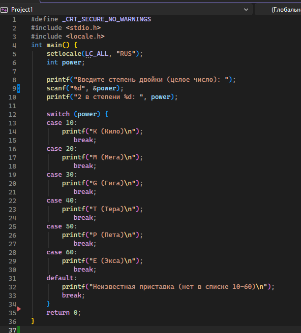

# Домашнее задание №7
## Условие задачи
Напишите программу, которая интерпретирует степени 2 в соответствующие приставки (10-K, 20-M,G,T,P,E).
## 1. Алгоритм и блок-схема
### Алгоритм
1. **Начало**
2. Ввести число N (степень).
3. Если N=10, вывести K(Кило).
4. Если N=20, вывести М(Мега).
5. Если N=30, вывести G(Гига).
6. Если N=40, вывести T(Тера).
7. Если N=50, вывести Р(Пета).
8. Если N=60, вывести Е(Экса).
9. Иначе: вывести "Неизвестная приставка".
10. **Конец**
   ### Блок-схема
    
## 2. Реализация программы 

## 3.Результаты работы программы
Введите степень двойки (целое число): 20
2 в степени 20: M (Мега)
Введите степень двойки (целое число): 70
2 в степени 70: Неизвестная приставка
## 4. Информация о разработчике
Панкова Дарья, бИЦТ-262
